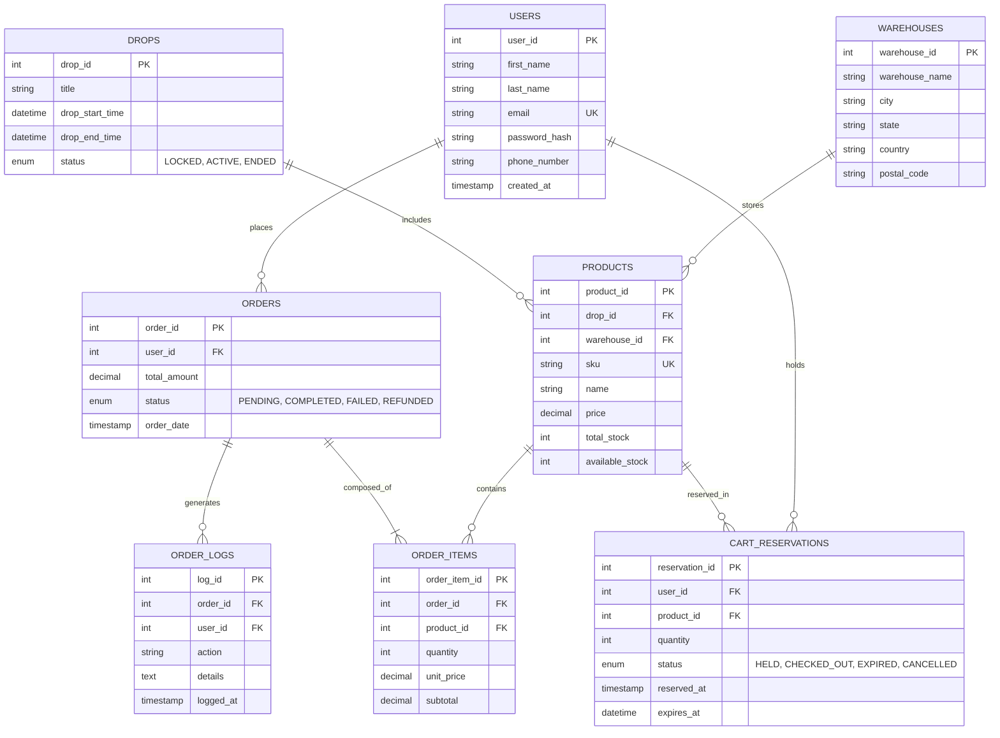

# ⚡ FlashDrop: High-Concurrency Product Release Engine

> A high-performance Relational Database Management System (DBMS) designed for limited-edition flash drops (e.g., sneaker releases, exclusive merchandise). Engineered to handle extreme concurrency, eliminate race conditions, guarantee zero overselling, and automate operational workflows through triggers and scheduled events.

---

## 📋 Table of Contents
1. [Project Overview](#project-overview)
2. [Database Architecture & 3NF Normalization](#database-architecture--3nf-normalization)
3. [Entity-Relationship (ER) Diagram](#entity-relationship-er-diagram)
4. [ACID Concurrency Engine](#acid-concurrency-engine)
5. [Active Database Logic (Triggers)](#active-database-logic-triggers)
6. [Scheduled Database Events](#scheduled-database-events)
7. [Database Views & Indexing](#database-views--indexing)
8. [File Structure & Installation](#file-structure--installation)

---

## 1. Project Overview

In conventional e-commerce, shopping carts are passive. In a **Flash Drop** (such as Nike SNKRS or Supreme releases), thousands of users attempt to purchase dozens of items within the exact same millisecond. 

Without advanced database engineering, two fatal bugs occur:
1. **Overselling (Race Condition):** Two concurrent transactions read `stock = 1`, and both decrement it, causing `stock = -1` and selling non-existent goods.
2. **Ghost Locks / Cart Hoarding:** Users lock up inventory by holding items in their cart indefinitely, preventing legitimate buyers from purchasing.

**FlashDrop solves both problems entirely within the database layer** using MySQL 8.0 InnoDB row locks, atomic stored procedures, invariant validation triggers, and event schedulers.

---

## 2. Database Architecture & 3NF Normalization

The schema is strictly normalized up to **Third Normal Form (3NF)** to ensure zero redundancy and maximum referential integrity:

| Entity | Primary Key | Normalization Justification |
| :--- | :--- | :--- |
| **`users`** | `user_id` | **1NF**: Atomic fields (`first_name`, `last_name`), unique email constraint, no repeating groups. |
| **`warehouses`** | `warehouse_id` | **3NF**: Warehouse address and location details are isolated into a separate entity rather than embedded in products, eliminating transitive dependencies. |
| **`drops`** | `drop_id` | **2NF**: Separates the drop campaign schedule from individual inventory items. |
| **`products`** | `product_id` | **2NF & 3NF**: Every attribute depends directly and entirely on the product primary key. Enforces `CHECK (available_stock >= 0)`. |
| **`cart_reservations`** | `reservation_id` | Handles time-to-live (TTL) inventory holds (5-minute expiration window). |
| **`orders`** | `order_id` | Records finalized financial transactions. |
| **`order_items`** | `order_item_id` | **1NF**: Resolves many-to-many relationship between orders and products. Stores historical snapshot prices. |
| **`order_logs`** | `log_id` | Immutable security audit trail populated automatically via database triggers. |

---

## 3. Entity-Relationship (ER) Diagram



---

## 4. ACID Concurrency Engine

The core logic is implemented through two transactional stored procedures:

### A. `sp_reserve_product` (Pessimistic Locking)
* **Mechanic:** Uses `SELECT ... FOR UPDATE` on the target product row.
* **Why it matters:** When 1,000 requests hit simultaneously, MySQL serializes access at the row level. Only users with valid remaining stock receive a confirmed reservation; all subsequent requests immediately receive `OUT_OF_STOCK`.
* **Reservation TTL:** Holds the reserved stock for exactly 5 minutes (`expires_at = NOW() + INTERVAL 5 MINUTE`).

### B. `sp_complete_checkout` (Atomic Finalization)
* Converts an active `HELD` reservation into a permanent order.
* Verifies that the reservation has not expired.
* Generates `orders` and `order_items` records and updates the reservation to `CHECKED_OUT` within a single atomic transaction.

---

## 5. Active Database Logic (Triggers)

1. **`trg_prevent_oversell` (`BEFORE UPDATE ON products`)**
   * Acts as an unbypassable defensive barrier.
   * If any query or bug attempts to update `available_stock < 0`, the trigger invokes `SIGNAL SQLSTATE '45000'` and aborts the entire transaction.
2. **`trg_order_audit_trail` (`AFTER INSERT ON orders`)**
   * Automatically logs new orders into `order_logs` for compliance and fraud detection.
3. **`trg_order_status_update_log` (`AFTER UPDATE ON orders`)**
   * Records lifecycle changes (e.g. from `COMPLETED` to `REFUNDED`) into the audit trail.

---

## 6. Scheduled Database Events

Powered by MySQL's native `EVENT SCHEDULER`:

1. **`evt_unlock_flash_drops` (Runs every 10 seconds)**
   * Automatically activates drops whose start time has arrived (`status = 'ACTIVE'`).
   * Automatically concludes drops when their end time passes (`status = 'ENDED'`).
2. **`evt_sweep_expired_carts` (Runs every 30 seconds)**
   * Finds reservations where `status = 'HELD'` and `expires_at < NOW()`.
   * Automatically re-credits the reserved quantity back to `products.available_stock` and flags the reservation as `EXPIRED`.

---

## 7. Database Views & Indexing

* **`v_trending_products`**: Computes live sell-through percentages, velocity, and revenue generated per product for homepages.
* **`v_user_order_history`**: Secure view masking authentication hashes and aggregating itemized order histories.
* **`v_inventory_monitor`**: Warehouse dashboard revealing live holds vs available stock.

---

## 8. File Structure & Installation

```
Flash-Drop/
├── README.md
├── sql/
│   ├── 01_schema.sql         # Table definitions & 3NF constraints
│   ├── 02_seed_data.sql       # Test drops, users, and limited inventory
│   ├── 03_procedures.sql      # ACID reservation and checkout engine
│   ├── 04_triggers.sql        # Negative stock protection & audit logging
│   ├── 05_events.sql          # Auto drop-unlocking & cart sweeper
│   ├── 06_views_indexes.sql   # Performance indexes & reporting views
│   └── init_all.sql           # One-command master runner
├── backend-spring/            # Production Spring Boot REST Engine
│   ├── pom.xml
│   └── src/main/
│       ├── java/com/flashdrop/
│       │   ├── controller/    # REST API endpoints & views
│       │   ├── dto/           # Request/response transfer objects
│       │   ├── model/         # JPA entities (Product, Drop, Order, CartReservation)
│       │   ├── repository/    # Spring Data JPA with @Lock(PESSIMISTIC_WRITE)
│       │   └── service/       # ACID transactions & programmatic TransactionTemplate
│       └── resources/
│           ├── application.properties
│           └── static/
│               └── index.html # High-concurrency live UI & simulator
└── simulation/
    └── test_concurrency.py    # Multi-threaded flash drop stress tester
```

### 1. Initialize Database via MySQL CLI:
```bash
mysql -u root -p < sql/init_all.sql
```

### 2. Run Spring Boot Backend:
```bash
cd backend-spring
mvn spring-boot:run
```
Web console & UI accessible at: **`http://localhost:8080`**
